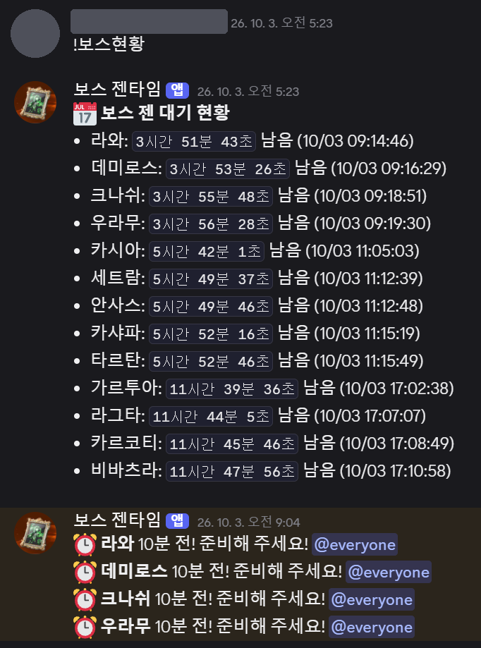
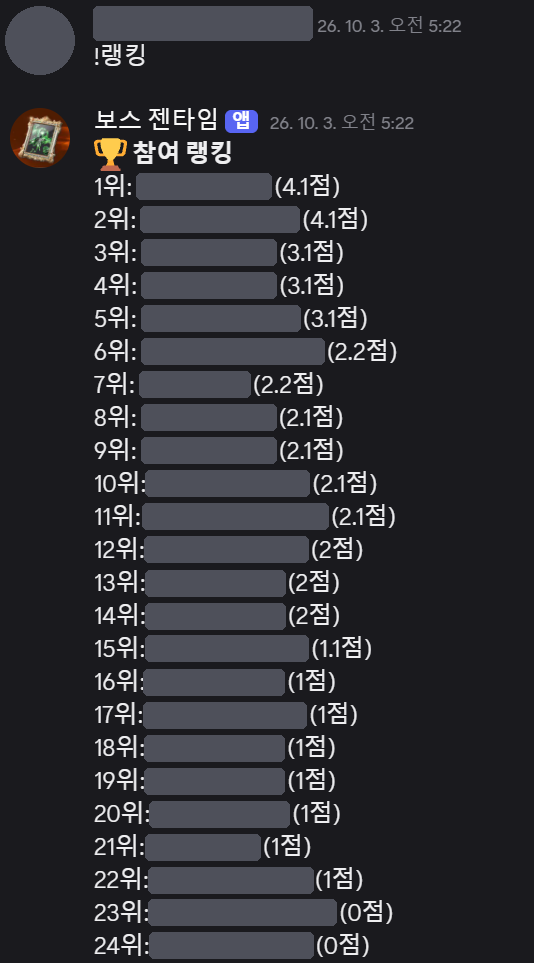
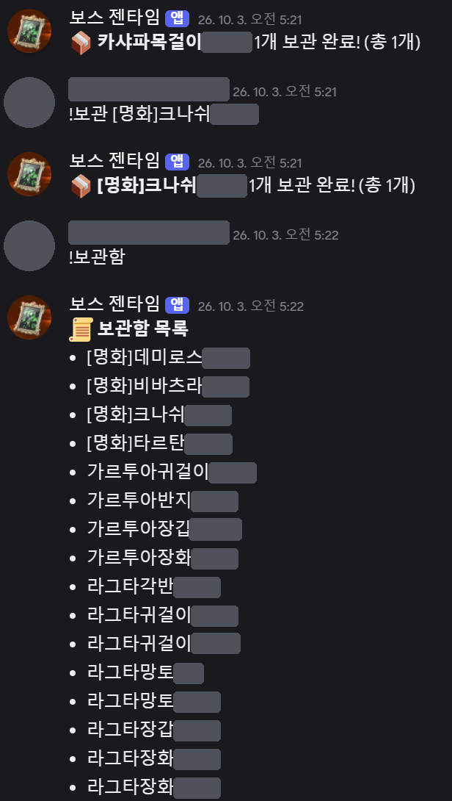
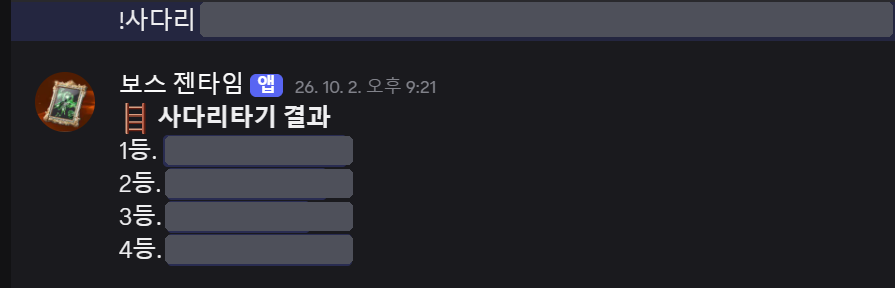
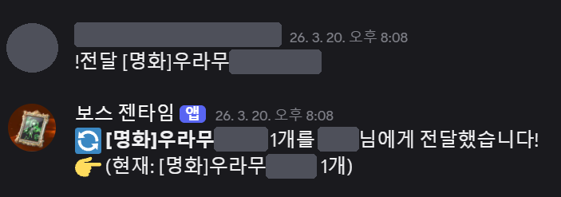
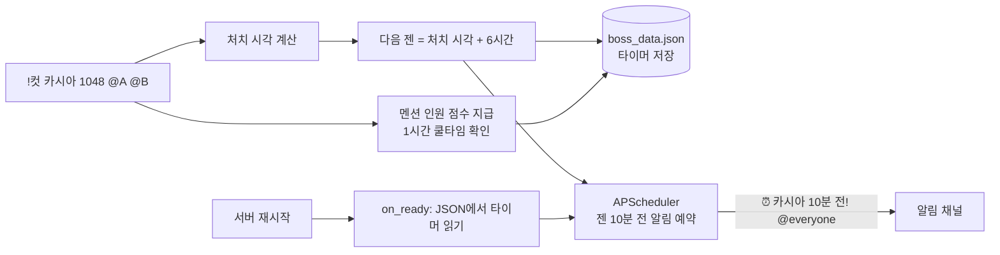

# ⚔️ 아이온2 보스 젠 타이머 디스코드 봇

> 아이온2를 하면서 필드 보스 젠(재등장) 시간을 일일이 재기가 힘들어서 만든 디스코드 봇입니다.
> 레기온 채널에 `!컷 보스이름`만 입력하면 **다음 젠 시간을 계산하고, 10분 전에 알림**을 보냅니다.
> 보스에 참여한 레기온원의 **참여 점수 랭킹**과 **레기온 보관함** 관리도 함께 합니다.

<p align="center"></p>
<p align="center"><sub>실제 레기온 서버에서 운영한 화면 (레기온원 닉네임·프로필은 가림)</sub></p>

<br>

## 📌 목차
1. [프로젝트 개요](#-프로젝트-개요)
2. [주요 기능](#-주요-기능)
3. [실제 사용 화면](#-실제-사용-화면)
4. [동작 방식](#-동작-방식)
5. [점수 규칙](#-점수-규칙)
6. [실행 방법](#-실행-방법)
7. [트러블슈팅](#-트러블슈팅)
8. [폴더 구조](#-폴더-구조)
9. [배운 점과 개선할 점](#-배운-점과-개선할-점)

<br>

## 📖 프로젝트 개요

| 항목 | 내용 |
|---|---|
| 기간 | 2026.01 ~ 2026.10 (레기온에서 실제 운영, 현재는 운영 종료) |
| 인원 | 1명 (개인 프로젝트) |
| 사용처 | 아이온2 레기온(길드) 디스코드 서버 |
| 운영 환경 | 클라우드 리눅스 서버(AWS EC2)에서 24시간 실행했음 |
| 기술 | Python, discord.py, APScheduler, JSON |

**왜 만들었나**
- 아이온2 필드 보스는 처치 후 4·6·12시간마다 다시 나타나는데, 보스가 10개가 넘다 보니 누가 언제 잡았는지 메모장으로 관리하기가 어려웠습니다.
- 레기온원 누가 보스에 많이 참여했는지도 공정하게 기록할 방법이 필요했습니다.

<br>

## ✨ 주요 기능

### 보스 타이머
| 명령어 | 설명 | 예시 |
|---|---|---|
| `!컷 보스 [시간] [@멘션...]` | 처치 기록 → 다음 젠 시간 계산, 10분 전 알림 예약, 멘션한 인원에게 점수 지급 | `!컷 카시아 @A @B` |
| `!보스현황` | 대기 중인 보스를 젠이 빠른 순으로 정렬해 남은 시간 표시 | |
| `!타이머삭제 보스` | 보스 하나의 타이머만 삭제 | `!타이머삭제 카시아` |
| `!타이머초기화` | 모든 타이머 삭제 | |

**처치 시간 입력 형식** (생략하면 "지금" 처치한 것으로 계산)

| 입력 | 의미 |
|---|---|
| `30` | 30분 전에 처치 |
| `1048` / `10:48` | 10시 48분에 처치 |
| `104800` / `10:48:00` | 10시 48분 00초에 처치 |

> 입력한 시각이 지금보다 1시간 넘게 뒤라면 **전날** 처치한 것으로 봅니다. (예: 새벽 1시에 `2330` 입력 → 어제 23:30)

**보스 목록과 젠 주기**

| 젠 주기 | 보스 |
|---|---|
| 12시간 | 가르투아, 라그타, 카르코티, 비바츠라 |
| 6시간 | 세트람, 안사스, 카시아, 카샤파, 타르탄 |
| 4시간 | 데미로스, 크나쉬, 라와, 우라무 |
| 1시간 | 테스트 (중복 참여 테스트용) |
| 타이머 없음 | 점검보스 (점검 직후 동시 젠 보상용) |

### 참여 점수
| 명령어 | 설명 |
|---|---|
| `!랭킹` | 참여 점수 순위 |
| `!참여추가 @유저 점수` / `!참여차감 @유저 점수` | 운영진이 점수를 직접 조정 |
| `!참여초기화` | 전체 점수 초기화 |

### 레기온 보관함
| 명령어 | 설명 |
|---|---|
| `!보관 아이템 [개수]` / `!보관삭제 아이템 [개수]` | 아이템 추가·삭제 |
| `!보관함` | 목록 보기 — `[명화]` 아이템을 맨 위에, 나머지는 가나다순 |
| `!전달 아이템[소유자] 새소유자 [개수]` | 아이템 소유자 변경 (예: `!전달 [명화]우라무[A] B`) |
| `!일괄전달 이전소유자 새소유자` | 한 사람 명의의 아이템을 전부 다른 사람에게 넘김 |
| `!명화초기화` / `!일반초기화` / `!보관함초기화` | 종류별 일괄 삭제 |

### 기타
| 명령어 | 설명 |
|---|---|
| `!사다리 이름1 이름2 ...` | 순서를 무작위로 섞어 등수 발표 |

<br>

## 📸 실제 사용 화면

레기온원 닉네임과 프로필 사진, 보관함 아이템의 소유자 이름은 가렸습니다.

| 보스 현황과 10분 전 알림 | 참여 랭킹 |
|:---:|:---:|
|  |  |
| **보관함** (`[명화]` 맨 위, 나머지 가나다순) | **사다리타기** |
|  |  |
| **아이템 전달** (소유자 이름이 바뀜) | |
|  | |

<br>

## ⚙️ 동작 방식



- **데이터 보존**: 타이머·점수·보관함·쿨타임을 모두 `boss_data.json`에 저장합니다. 서버가 재시작돼도 `on_ready`에서 파일을 읽어 남은 타이머의 알림을 다시 예약합니다.
- **타이머와 알림 분리**: 실제 젠 시간은 `boss_timers`에, 10분 전 알림은 스케줄러에 따로 둡니다. 그래서 알림이 울린 뒤에도 `!보스현황`에서 젠 직전까지 남은 시간이 계속 보입니다.
- **24시간 운영**: `run.sh`를 `nohup`으로 실행해, 봇이 어떤 이유로 꺼져도 5초 뒤에 다시 켜지게 했습니다.

<br>

## 🏅 점수 규칙

| 구분 | 점수 | 비고 |
|---|---|---|
| 일반 보스 (4·6시간) | 1.0 | 기본 점수 |
| 12시간 보스 | 1.1 | +0.1 보너스 |
| 점검보스 | 1.1 | 점검 직후 보스가 한꺼번에 젠되면 인원을 모으고 시간을 조율해야 해서 보너스. 스케줄에는 넣지 않음 |
| 같은 사람이 1시간 안에 다시 멘션됨 | 0 | 중복 참여 방지 (메시지에 "중복 제외"로 따로 표시) |

> 처음에는 **새벽 시간대(1:00~6:59) 처치에 +0.1점**을 줬지만, 새벽이라는 이유만으로 점수를 더 주는 건 형평성에 맞지 않다고 판단해 뺐습니다.

<br>

## 🚀 실행 방법

### 1. 디스코드 봇 준비
1. [Discord Developer Portal](https://discord.com/developers/applications)에서 애플리케이션과 봇을 만들고 토큰을 복사합니다.
2. **Bot → Privileged Gateway Intents**에서 `MESSAGE CONTENT INTENT`와 `SERVER MEMBERS INTENT`를 켭니다. (명령어 읽기, 멘션한 멤버 찾기에 필요)
3. 봇을 서버에 초대하고, 알림을 보낼 채널의 ID를 복사합니다. (채널 우클릭 → ID 복사, 개발자 모드 필요)

### 2. 설치와 실행
```bash
git clone https://github.com/Jongmin-Lee-DEV/aion2-boss-timer-bot.git
cd aion2-boss-timer-bot
pip install -r requirements.txt

cp .env.example .env     # .env 를 열어 DISCORD_TOKEN, CHANNEL_ID 입력
python3 boss.py          # "[봇이름] 모든 기능 복구 및 가동 시작!" 이 뜨면 성공
```

### 3. 서버에서 24시간 실행
```bash
nohup sh run.sh &        # 터미널을 닫아도 계속 실행, 꺼지면 5초 뒤 재시작
tail -f nohup.out        # 로그 보기 (Ctrl+C 로 빠져나와도 봇은 안 꺼짐)
pkill -f run.sh && pkill -f boss.py   # 완전히 끄기
```

<br>

## 🔧 트러블슈팅

| 증상 | 원인 | 해결 |
|---|---|---|
| `!컷 데미로스 104800` 을 했는데 타이머가 안 뜸 | 4자리만 시각으로 인식해서 6자리를 "104,800분 전(약 72일 전)"으로 계산 → 젠 시간이 이미 지나 버림 | 4자리·6자리·콜론 형식을 모두 시각으로 인식하게 바꾸고, 출력에 **월/일**까지 표시해 날짜 오류가 바로 보이게 함 |
| 닉네임의 `_` 때문에 이름이 기울임꼴로 깨짐 | 디스코드가 `_이름_` 을 마크다운 기울임으로 해석 | 처음엔 `_` 앞에 `\` 를 붙여 저장했지만, 최종적으로는 이름은 원래대로 저장하고 **출력할 때만** `discord.utils.escape_markdown()` 으로 처리 |
| 10분 전 알림이 울리면 `!보스현황` 에서 보스가 사라짐 | 현황을 스케줄러의 "알림 작업" 기준으로 계산했는데, 알림이 실행되면 작업이 삭제됨 | 실제 젠 시간을 담는 `boss_timers` 를 따로 두고 현황은 그 기준으로 계산 |
| 점수 저장 구조를 바꾼 뒤 `!랭킹` 이 오류 (`'float' object is not subscriptable`) | 기존 JSON은 `"이름": 점수`, 새 코드는 `"ID": {"name", "score"}` 를 기대해 서로 안 맞음 | 기존 데이터와 맞는 단순 구조(`"이름": 점수`)로 되돌림. 데이터 구조를 바꿀 땐 기존 파일 변환까지 같이 해야 한다는 걸 배움 |
| 봇 실행 시 `CommandRegistrationError: 보관함 is already an existing command` | 수정한 함수를 붙여넣으면서 예전 `!보관함` 함수를 안 지워 같은 명령어가 2개가 됨 | 중복 함수 삭제 |
| 봇을 재시작했더니 점수가 초기화됨 | 파일에 쓰는 도중 `kill -9` 로 강제 종료됐거나, 파일 비우기 명령(`>`)을 잘못 친 것으로 추정 | 점수 수동 복구. 이후 강제 종료 대신 `pkill` 로 끄고, 수정 전에 JSON을 백업 |
| 에러 로그 없이 봇이 꺼져 있음 | 파이썬 오류가 아니라 서버 재부팅·메모리 부족 등 OS 쪽에서 프로세스가 종료된 것으로 추정 | `while true` 재시작 루프(`run.sh`)를 `nohup` 으로 실행 |
| 봇 토큰이 코드에 그대로 들어 있음 | `bot.run('토큰')` 에 직접 입력 | 토큰을 `.env` 로 분리하고 `.gitignore` 에 추가 |

<br>

## 📁 폴더 구조

```
aion2-boss-timer-bot/
├── README.md
├── boss.py            # 봇 본체 (명령어, 타이머, 점수, 보관함)
├── run.sh             # 꺼지면 5초 뒤 다시 켜는 실행 스크립트
├── requirements.txt   # discord.py, apscheduler, python-dotenv
├── .env.example       # 토큰·채널 ID 입력 양식 (실제 .env 는 업로드 안 함)
├── .gitignore         # .env, boss_data.json, nohup.out 제외
└── docs/              # 실제 사용 화면 캡처 (닉네임 가림)
    ├── boss_status.png
    ├── ranking.png
    ├── storage.png
    ├── transfer.png
    └── ladder.png
```

`boss_data.json` 은 처음 실행할 때 자동으로 만들어지며, 다음과 같은 구조입니다.

```json
{
    "participation": { "레기온원A": 12.1, "레기온원B": 8 },
    "items": { "[명화]보스장갑[레기온원A]": 1, "강화석": 3 },
    "timers": { "카시아": "2026-07-24T16:48:00+09:00" },
    "cooldowns": { "레기온원A": "2026-07-24T10:48:00+09:00" }
}
```

<br>

## 📝 배운 점과 개선할 점

**배운 점**
- **실사용자 피드백으로 고치기** — 레기온원들이 실제로 쓰면서 나온 불편(6자리 시간 입력, 닉네임 깨짐, 알림 후 사라지는 타이머, 중복 참여)을 하나씩 고쳐 나갔습니다.
- **데이터는 코드보다 오래 남는다** — 코드를 바꿔도 기존 JSON 파일은 그대로라서, 저장 구조를 바꿀 때는 기존 데이터와의 호환을 먼저 생각해야 했습니다.
- **리눅스 서버 운영** — SSH 접속, `nano`, `tmux`, `nohup`, `ps`/`pkill` 로 프로세스를 관리하고, 로그 없이 꺼지는 문제를 재시작 루프로 해결했습니다.
- **비밀 정보 관리** — 토큰을 코드에 넣으면 공유하는 순간 유출된다는 걸 겪고 `.env` 로 분리했습니다.

**다시 만든다면 개선할 점**
- 초기화·점수 조정 명령어에 **운영진 권한 확인**이 없어 누구나 실행할 수 있음 → `@commands.has_role()` 로 운영진만 쓸 수 있게 제한
- 점수를 **닉네임 기준**으로 저장해서 닉네임을 바꾸면 기록이 따로 쌓임 → 디스코드 유저 ID 기준으로 옮기되, 기존 데이터 변환 스크립트를 함께 작성
- JSON 저장 중 강제 종료되면 파일이 깨질 수 있음 → 임시 파일에 쓴 뒤 교체하는 방식으로 개선
